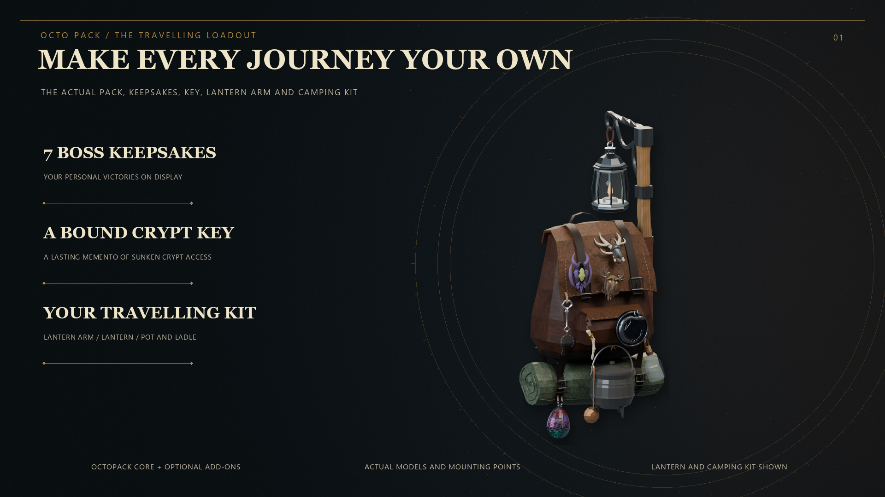
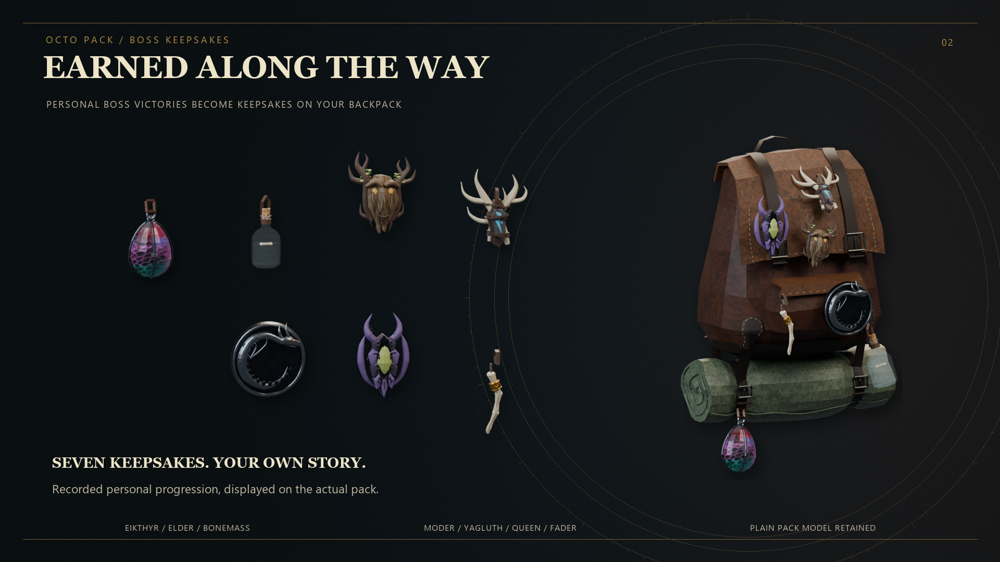
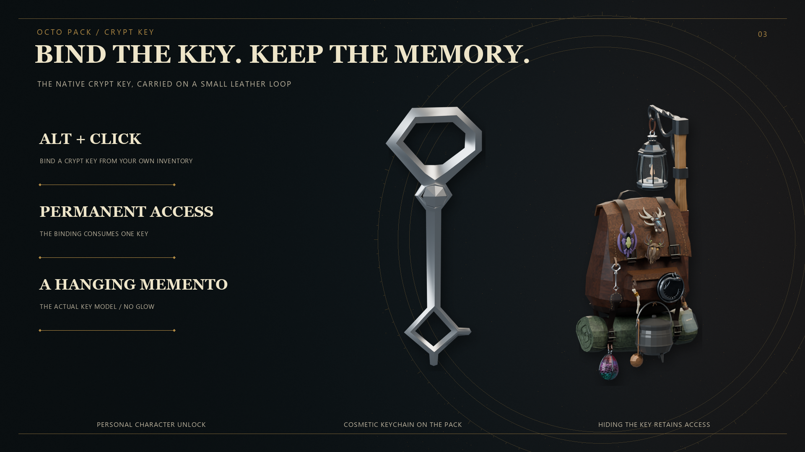
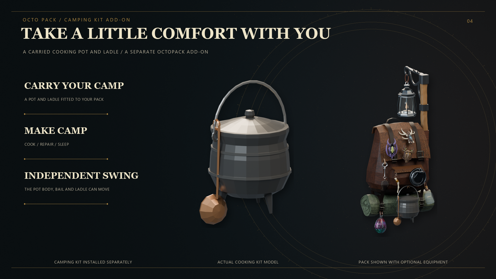
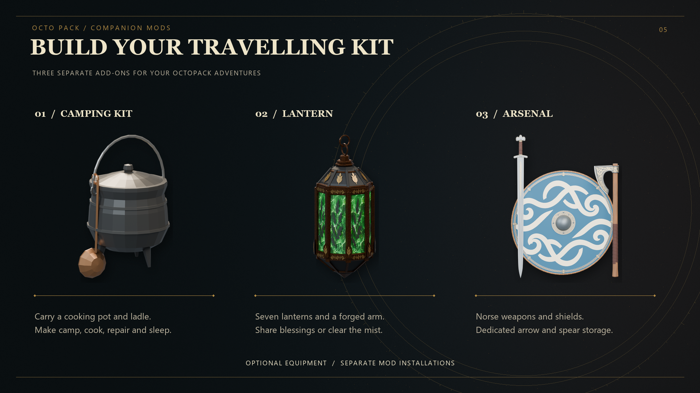

# OctoPack — More than just a backpack mod

Carry your supplies, display your travelling gear, and upgrade your backpack as you conquer Valheim's bosses. OctoPack adds dedicated backpack equipment and storage, with persistent cargo that stays inside when you remove or drop your pack.

*Full loadout shown with the separate Lantern and Camping add-ons installed.*

## Download

[Download the latest OctoPack release](https://github.com/octerockman/OctoPack/releases/latest).

Version **1.7.5** reduces the FPS drop while inventory is open by skipping unchanged slot, panel, and tooltip updates. The Deeper Pockets background fix from 1.7.4 remains included.

## Features

- **Eight progression tiers:** Start with the Traveller backpack and unlock seven sequential boss upgrades.
- **Expanded storage:** Progress from 4 to 24 backpack slots, with increasing carry bonuses.
- **Dedicated equipment slot:** Equip your backpack separately from ordinary armor.
- **Persistent cargo:** Items retain their positions inside an unequipped or dropped backpack. Picking it up equips it directly.
- **Dropped-pack physics:** Backpacks fall from their worn position and settle naturally.
- **Armor-stand support:** Hang your backpack on a stand while preserving its contents.
- **Visible equipment:** Display stowed weapons, shields, and boss keepsakes.
- **Grave recovery:** Recover your backpack and equipped accessories after death.
- **Movable inventory:** Alt-drag the backpack panel and equipment slot independently. The panel follows inventory growth until you move it.

## Boss keepsakes

Your personal boss victories become keepsakes displayed on your backpack. Seven keepsakes record your progression through Eikthyr, the Elder, Bonemass, Moder, Yagluth, the Queen, and Fader.

## Bind your crypt key

Hold Alt and left-click a Swamp Key in your inventory to bind permanent Sunken Crypt access to your character. Binding consumes one key and adds a hanging key memento to your pack. Hiding the cosmetic key does not remove your access.

## Optional Camping Kit

The separate Camping add-on fits a cooking pot and ladle to your backpack. Set up camp to cook, repair, and sleep, with the pot, bail, and ladle moving independently while carried.

*Camping is a separate installation and is not included in the OctoPack core download.*

## Build your travelling kit

Expand your setup with separate companion mods:

- **Camping Kit:** Carry a pot and ladle, then make camp.
- **Lantern:** Seven lanterns, an integrated lantern arm, aura abilities, and Wisp mist clearing.
- **OctoArsenal:** Norse weapons and shields with dedicated arrow and spear storage.

*The companion mods pictured above are optional, separate downloads.*

## Getting started

Craft the Traveller backpack at a level 1 workbench with 10 Deer Hide, 10 Leather Scraps, 4 Bone Fragments, and 2 Resin. Equip it in the pack slot. Later upgrades use the preceding pack and their boss progression requirements.

## Default controls

| Action | Control |
| --- | --- |
| Drop the equipped backpack with its cargo | Either Shift + R |
| Hang or remove a pack at an armor stand | Shift + Use; E is the default Use key |
| Move the backpack inventory panel or pack equipment slot | Hold Alt and drag with the left mouse button |
| Bind a Swamp Key to your character | Alt + left-click the key in your inventory |
| Reload configuration | F6 |

The backpack inventory continues to follow changes in player inventory height until you actually drag it. The panel and equipment slot can be moved independently.

## Configuration

The configuration file is generated at:

`BepInEx/config/OctoPack.cfg`

Settings cover inventory behavior, equipment displays, mount positions, backpack motion, cape visibility, and controls. Existing configuration is preserved when updating.

## Requirements and installation

Requires BepInEx for Valheim. Install with your Thunderstore-compatible mod manager.

For manual installation, close Valheim and copy the package's `plugins` folder into your existing `BepInEx` folder. The resulting file is:

`BepInEx/plugins/OctoPack/OctoPack.dll`

Keep one copy of the DLL and retain your configuration when updating.

### Multiplayer and dedicated servers

Install the same OctoPack version on participating clients and the dedicated server. The server uses the identical DLL; there is no separate server DLL.

For the current paired release, use OctoPack **1.7.5** with Lantern **1.2.3**. A dedicated server needs the core DLL; it does not need Lantern or Camping for their client visuals.

## Compatibility

Equipment and Quick Slots, Path of Valheiman, and OctoArsenal integrations are optional; they are not required downloads. Compatibility depends on the versions and settings of the other installed mods.

Remove the legacy `Octodad.Backpack` plugin before using this core. Avoid duplicate copies of OctoPack.

Lantern and Camping are separate optional add-ons. Neither add-on DLL is bundled in the OctoPack core package.

## Development disclosure

Developed with AI assistance from OpenAI Codex.

## Community and support

Join [OctoDad's Mods on Discord](https://discord.gg/RueyvSfX7R) to ask questions, report bugs, and get news about future mods.

## Credits

Created by OctoDad / Bascinet.
